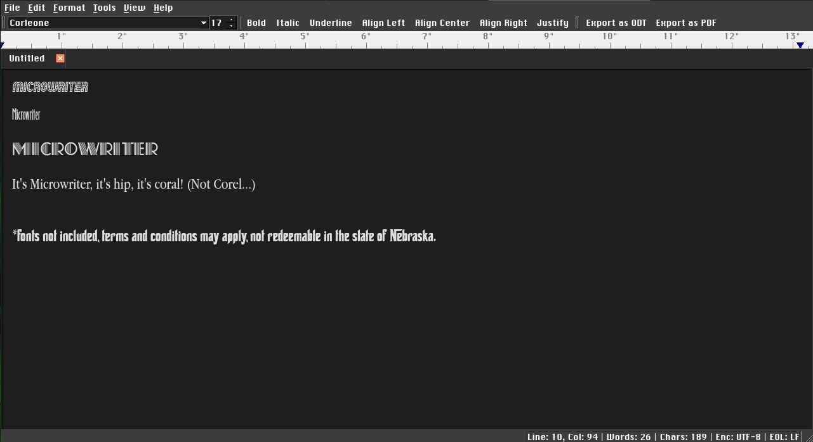
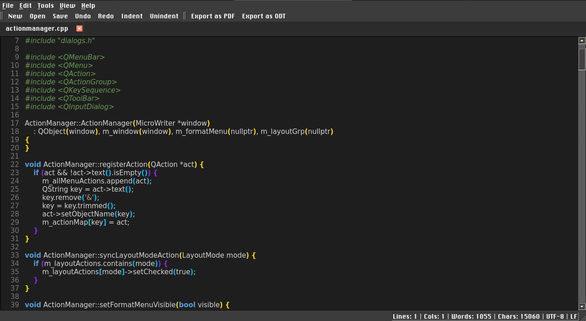
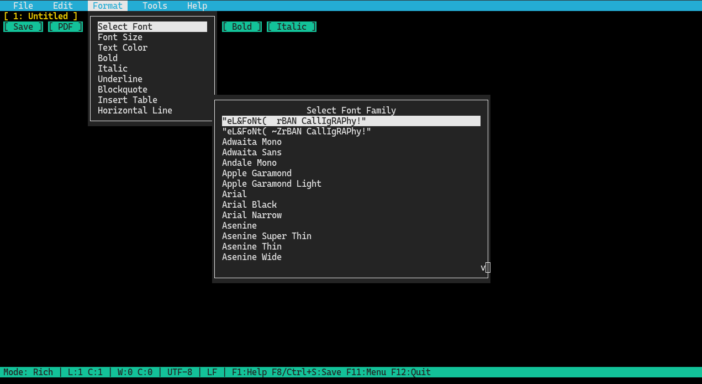

<strong>The diet soda of word processors, same refreshing taste, half the calories!</strong>

<strong>Version 2.7, released on October 28th, 2026</strong>

A lightweight, distraction-free rich text editor and code notepad built with C++ and Qt. MicroWriter combines the simplicity of a classic notepad with essential word processing tools, multi-tab editing, and versatile document export capabilities.

  


• <strong>Multi-Tab Interface:</strong> Work on multiple documents simultaneously with per-tab layout memory.
• <strong>Rich Text Formatting:</strong> Bold, italic, underline, strikethrough, text color, highlight color, font family, and font size.
• <strong>Four Layout Modes:</strong> Switch seamlessly between Normal, Web, Print, and Code Layout modes.
• <strong>Dedicated Code Mode:</strong> Clean code editor with line numbering, bracket matching, syntax highlighting, and auto-detection for common source files.
• <strong>Safety Lockout:</strong> Prevents a user from accidentally switching to rich text edit mode while working on source files.
• <strong>Context-Aware Menus:</strong> The Format menu automatically hides while working in Code Layout to keep the workspace clean and focused.
• <strong>Dual-Profile Customizable Toolbars:</strong> Separate, persistent toolbar setups for Rich Text and Code modes—right-click any toolbar to customize buttons, create new stacked rows, or remove bars.
• <strong>Universal Find and Replace:</strong> Fast text and regex search with match replacement across both rich text and code editors.
• <strong>Document Ruler:</strong> Visual interactive ruler for margins and tabs.
• <strong>Live Statistics:</strong> Real-time character count, word count, line/column tracking, encoding display, and newline mode detection (CRLF, LF, CR).
• <strong>Dark Mode Support:</strong> Clean light and dark theme toggling.
• <strong>Multi-Format Support:</strong> Open and save Markdown (<code>.md</code>), HTML (<code>.html</code>), plain text (<code>.txt</code>), and source code files, plus export to PDF and ODT.


• <strong>C++17 compatible compiler (GCC or Clang)</strong>
• <strong>CMake 3.16 or higher</strong>
• <strong>ncurses library (with wide-character/mouse support)</strong>
• <strong>fontconfig (recommended for full system font discovery)</strong>
• <strong>wl-clipboard (wl-copy/wl-paste) or xclip / xsel (for external clipboard integration)</strong>
• <strong>Qt 6 (Core, Gui, Widgets, PrintSupport - for shared build target)</strong>


```bash
mkdir build && cd build
cmake ..
cmake --build .

microwriter -c [file1] [file2] ...
microwriter --console [file1] [file2] ...

microwriter -C [file1] [file2] ...
microwriter --code [file1] [file2] ...